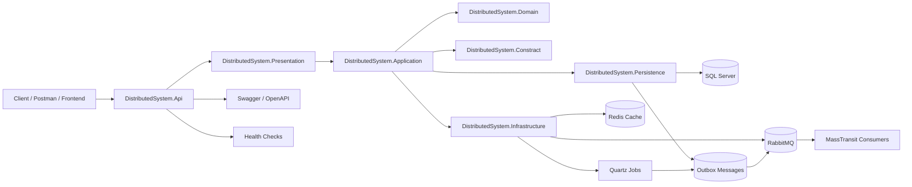
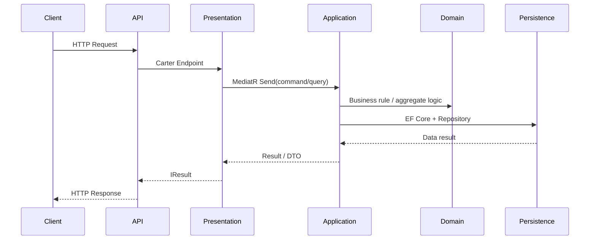

# DistributedSystem - Tổng quan kiến trúc và chức năng

## 1. Mục tiêu dự án

Dự án này là một ứng dụng ASP.NET Core theo hướng layered architecture / Clean Architecture, tập trung vào:

- API REST với versioning
- Xử lý nghiệp vụ bằng MediatR
- Dữ liệu với Entity Framework Core + SQL Server
- Xác thực JWT
- Cache Redis
- Message bus RabbitMQ + MassTransit
- Background job Quartz
- Health check
- Outbox pattern để đảm bảo publish event đáng tin cậy

---

## 2. Cấu trúc solution

Các project chính trong solution:

- [DistributedSystem.Api](DistributedSystem.Api) — Entry point, cấu hình ASP.NET Core, Swagger, JWT, health-check, DI.
- [DistributedSystem.Application](DistributedSystem.Application) — Logic nghiệp vụ, handlers, pipeline behaviors, validation.
- [DistributedSystem.Domain](DistributedSystem.Domain) — Domain model, entity, aggregate root, repository abstractions.
- [DistributedSystem.Constract](DistributedSystem.Constract) — Commands, queries, responses, shared abstractions, DTOs, contracts.
- [DistributedSystem.Infrastructure](DistributedSystem.Infrastructure) — Redis, JWT, RabbitMQ, Quartz jobs, async messaging, external integrations.
- [DistributedSystem.Persistence](DistributedSystem.Persistence) — DbContext, repositories, EF configuration, SQL Server, UnitOfWork, outbox.
- [DistributedSystem.Presentation](DistributedSystem.Presentation) — Carter endpoint modules, API routing endpoints.
- [DistributedSystem.Test](DistributedSystem.Test) — Architecture tests.

File solution chính:

- [DistributedSystem.sln](DistributedSystem.sln)
- [Directory.Build.props](Directory.Build.props)

---

## 3. Kiến trúc tổng thể

### 3.1 Sơ đồ Mermaid

### 3.2 Sơ đồ phụ thuộc

Dự án đang theo hướng:

- API -> Application -> Domain / Constract
- Infrastructure -> Application / Persistence
- Persistence -> Domain
- Presentation -> Application / Contract

Tức là:

- Tầng Domain là tầng lõi, không phụ thuộc vào API hoặc Infrastructure.
- Application chứa use-case logic và orchestration.
- Infrastructure tích hợp công nghệ bên ngoài như Redis, RabbitMQ, JWT, Quartz.
- Persistence quản lý cơ sở dữ liệu và repository.
- API chỉ là nơi expose endpoint cho client.

### 3.2 Kiến trúc thực tế đang theo dạng

- Clean Architecture / layered architecture
- CQRS-ish qua MediatR
- Event-driven via domain events + MassTransit + Outbox
- SQL Server + EF Core phục vụ persistence
- JWT authentication
- Cache và message bus cho hệ thống phân tán

---

## 4. Chức năng từng project

## 4.1 [DistributedSystem.Api](DistributedSystem.Api)

### File quan trọng

- [DistributedSystem.Api/Program.cs](DistributedSystem.Api/Program.cs)
- [DistributedSystem.Api/DependencyInjection/Extensions/JwtExtensions.cs](DistributedSystem.Api/DependencyInjection/Extensions/JwtExtensions.cs)
- [DistributedSystem.Api/DependencyInjection/Extensions/SwaggerExtensions.cs](DistributedSystem.Api/DependencyInjection/Extensions/SwaggerExtensions.cs)
- [DistributedSystem.Api/Middleware/ExceptionHandlingMiddleware.cs](DistributedSystem.Api/Middleware/ExceptionHandlingMiddleware.cs)

### Chức năng

- Khởi tạo và cấu hình ASP.NET Core app.
- Cài đặt logging bằng Serilog.
- Đăng ký Swagger cho API docs.
- Đăng ký versioning API.
- Cấu hình JWT authentication.
- Cài đặt Mediator, AutoMapper, Quartz, Redis, RabbitMQ, HealthChecks.
- Kết nối database với SQL Server thông qua persistence layer.
- Gắn middleware xử lý exception toàn cục.
- Map các endpoint từ Carter.
- Expose endpoint /health cho health check.

### Điểm đáng chú ý

- Dùng `builder.Services.AddCarter();` và `app.MapCarter();` để map module endpoint.
- Có gọi `app.UseSwaggerApi();` khi môi trường là Development hoặc Staging.
- Có `app.UseAuthentication();` và `app.UseAuthorization();` để bảo vệ API.

---

## 4.2 [DistributedSystem.Application](DistributedSystem.Application)

### File quan trọng

- [DistributedSystem.Application/DependencyInjection/Extensions/ServiceCollectionExtensions.cs](DistributedSystem.Application/DependencyInjection/Extensions/ServiceCollectionExtensions.cs)
- [DistributedSystem.Application/Behaviors/ValidationPipelineBehavior.cs](DistributedSystem.Application/Behaviors/ValidationPipelineBehavior.cs)
- [DistributedSystem.Application/Behaviors/TransactionPipelineBehavior.cs](DistributedSystem.Application/Behaviors/TransactionPipelineBehavior.cs)
- [DistributedSystem.Application/Behaviors/PerformancePipelineBehavior.cs](DistributedSystem.Application/Behaviors/PerformancePipelineBehavior.cs)
- [DistributedSystem.Application/Mapper/ServiceProfile.cs](DistributedSystem.Application/Mapper/ServiceProfile.cs)
- [DistributedSystem.Application/UserCases/V1/Commands/Product/CreateProductCommandHandler.cs](DistributedSystem.Application/UserCases/V1/Commands/Product/CreateProductCommandHandler.cs)
- [DistributedSystem.Application/UserCases/V1/Queries/Product/GetProductsQueryHandler.cs](DistributedSystem.Application/UserCases/V1/Queries/Product/GetProductsQueryHandler.cs)
- [DistributedSystem.Application/UserCases/V1/Queries/Identity/GetLoginQueryHandler.cs](DistributedSystem.Application/UserCases/V1/Queries/Identity/GetLoginQueryHandler.cs)

### Chức năng

- Đăng ký MediatR với pipeline behaviors.
- Đăng ký AutoMapper.
- Validation request qua FluentValidation.
- Transaction pipeline cho command.
- Performance logging cho request chạy lâu quá 5s.
- Thực thi logic Create / Update / Delete / Get Product.
- Xử lý auth login, tạo access token, refresh token, cache token.

### Behaviors chính

#### ValidationPipelineBehavior
- Kiểm tra request có validator không.
- Nếu có lỗi validation thì trả về ValidationResult thay vì chạy business logic.
- Được đăng ký như một MediatR pipeline behavior.

#### TransactionPipelineBehavior
- Nếu request là command, bắt đầu transaction.
- Sau khi handler thực thi xong, save change và commit transaction.
- Dùng execution strategy của EF Core

#### PerformancePipelineBehavior
- Đo thời gian xử lý request.
- Nếu request chạy quá lâu sẽ log warning.

---

## 4.3 [DistributedSystem.Domain](DistributedSystem.Domain)

### File quan trọng

- [DistributedSystem.Domain/Entities/Product.cs](DistributedSystem.Domain/Entities/Product.cs)
- [DistributedSystem.Domain/Repositories/IRepositoryBase.cs](DistributedSystem.Domain/Repositories/IRepositoryBase.cs)
- [DistributedSystem.Domain/Entities/Identity](DistributedSystem.Domain/Entities/Identity)

### Chức năng

- Định nghĩa entity và aggregate root.
- Product là AggregateRoot với các vùng dữ liệu:
  - Name
  - Price
  - Description
  - CreatedOnUtc / UpdatedOnUtc
- Product có method:
  - CreateProduct()
  - UpdateProduct()
  - DeleteProduct()
- Khi product được tạo/cập nhật/xóa, nó raise domain event.

### Chốt kiến trúc

- Domain layer chứa business rules và aggregate behavior.
- Không chứa logic database.
- Repository interface được định nghĩa ở đây, còn implementation ở Persistence.

---

## 4.4 [DistributedSystem.Constract](DistributedSystem.Constract)

### File quan trọng

- [DistributedSystem.Constract/Services/V1/Product/Command.cs](DistributedSystem.Constract/Services/V1/Product/Command.cs)
- [DistributedSystem.Constract/Services/V1/Product/Query.cs](DistributedSystem.Constract/Services/V1/Product/Query.cs)
- [DistributedSystem.Constract/Services/V1/Product/DomainEvent.cs](DistributedSystem.Constract/Services/V1/Product/DomainEvent.cs)
- [DistributedSystem.Constract/Services/V1/Identity/Query.cs](DistributedSystem.Constract/Services/V1/Identity/Query.cs)
- [DistributedSystem.Constract/Services/V1/Identity/Response.cs](DistributedSystem.Constract/Services/V1/Identity/Response.cs)

### Chức năng

- Định nghĩa command, query, response, domain events cho ứng dụng.
- Dùng record để mô tả request/response trong Mediator.

### Ví dụ

#### Product commands
- CreateProductCommand
- UpdateProductCommand
- DeleteProductCommand

#### Product query
- GetProductsQuery
- GetProductByIdQuery

#### Identity query
- Login
- RefreshToken
- RevokeToken

Các loại contract này dùng như API contract nội bộ giữa Presentation -> Application.

---

## 4.5 [DistributedSystem.Persistence](DistributedSystem.Persistence)

### File quan trọng

- [DistributedSystem.Persistence/ApplicationDbContext.cs](DistributedSystem.Persistence/ApplicationDbContext.cs)
- [DistributedSystem.Persistence/Repositories/RepositoryBase.cs](DistributedSystem.Persistence/Repositories/RepositoryBase.cs)
- [DistributedSystem.Persistence/EFUnitOfWork.cs](DistributedSystem.Persistence/EFUnitOfWork.cs)
- [DistributedSystem.Persistence/EFUnitOfWorkDbContext.cs](DistributedSystem.Persistence/EFUnitOfWorkDbContext.cs)
- [DistributedSystem.Persistence/DependencyInjections/Extensions/ServiceCollectionExtensions.cs](DistributedSystem.Persistence/DependencyInjections/Extensions/ServiceCollectionExtensions.cs)
- [DistributedSystem.Persistence/Outbox/OutboxMessage.cs](DistributedSystem.Persistence/Outbox/OutboxMessage.cs)
- [DistributedSystem.Persistence/Interceptors](DistributedSystem.Persistence/Interceptors)

### Chức năng

- Cấu hình EF Core với SQL Server.
- Khởi tạo IdentityDbContext cho AppUser, AppRole.
- Đăng ký repositories generic.
- Đăng ký UnitOfWork.
- Kết nối `AddSqlServerPersistence()` và `AddRepositoryPersistence()`.
- Sử dụng interceptor để cập nhật audit fields và chuyển domain event sang Outbox.
- Hỗ trợ retry strategy với SqlServerRetryOptions.

### Chú ý quan trọng

- `ApplicationDbContext` kế thừa `IdentityDbContext<AppUser, AppRole, Guid>`.
- `ApplicationDbContext` áp dụng tất cả configuration từ assembly.
- Eager/lazy loading được cấu hình với `UseLazyLoadingProxies(true)`.

---

## 4.6 [DistributedSystem.Infrastructure](DistributedSystem.Infrastructure)

### File quan trọng

- [DistributedSystem.Infrastructure/DependencyInjections/Extensions/ServiceCollectionExtensions.cs](DistributedSystem.Infrastructure/DependencyInjections/Extensions/ServiceCollectionExtensions.cs)
- [DistributedSystem.Infrastructure/Authentication/JwtTokenService.cs](DistributedSystem.Infrastructure/Authentication/JwtTokenService.cs)
- [DistributedSystem.Infrastructure/Caching/CacheService.cs](DistributedSystem.Infrastructure/Caching/CacheService.cs)
- [DistributedSystem.Infrastructure/BackgroundJobs/ProcessOutboxMessagesJob.cs](DistributedSystem.Infrastructure/BackgroundJobs/ProcessOutboxMessagesJob.cs)

### Chức năng

#### JWT
- `JwtTokenService` tạo access token và refresh token.
- Dùng `JwtSecurityToken` và `SymmetricSecurityKey`.
- Hỗ trợ decode token expired thông qua `GetPrincipalFromExpiredToken`.

#### Cache
- `CacheService` sử dụng `IDistributedCache`.
- Có hỗ trợ set/get/remove cache và xóa theo prefix.
- Lưu dữ liệu dưới dạng JSON.

#### RabbitMQ / MassTransit
- Đăng ký consumers và bus RabbitMQ.
- Cấu hình serializer JSON với type handling.
- Kebab case endpoint name formatter.
- Kết nối với receive/consume/publish/send observer để log.

#### Quartz
- Khởi tạo background job `ProcessOutboxMessagesJob`.
- Job này lấy message từ Outbox, deserialize event, publish qua MassTransit.

#### Health checks
- Kiểm tra SQL Server, Redis, RabbitMQ, MongoDB.

---

## 4.7 [DistributedSystem.Presentation](DistributedSystem.Presentation)

### File quan trọng

- [DistributedSystem.Presentation/Apis/Products/ProductApi.cs](DistributedSystem.Presentation/Apis/Products/ProductApi.cs)
- [DistributedSystem.Presentation/Apis/Identity/AuthApi.cs](DistributedSystem.Presentation/Apis/Identity/AuthApi.cs)

### Chức năng

- Định nghĩa các endpoint bằng Carter.
- Tạo module routing cho product và auth.

### Product endpoint

- POST /api/v{version}/products
- GET /api/v{version}/products
- GET /api/v{version}/products/{productId}
- PUT /api/v{version}/products/{productId}
- DELETE /api/v{version}/products/{productId}

### Auth endpoint

- POST /api/v{version}/auths/login
- POST /api/v{version}/auths/revoke
- POST /api/v{version}/auths/refresh

---

## 5. Chức năng nghiệp vụ chính

## 5.0 Phân tích folder theo từng project

### [DistributedSystem.Api](DistributedSystem.Api)

- [DistributedSystem.Api/Program.cs](DistributedSystem.Api/Program.cs): khởi tạo host, đăng ký services, middleware, health check và chạy app.
- [DistributedSystem.Api/DependencyInjection/Extensions](DistributedSystem.Api/DependencyInjection/Extensions): chứa các extension thêm Swagger, JWT.
- [DistributedSystem.Api/Middleware](DistributedSystem.Api/Middleware): middleware xử lý exception tổng quát.
- [DistributedSystem.Api/Controllers](DistributedSystem.Api/Controllers): nếu có controller, nhưng trong dự án hiện tại phần lớn đang dùng Carter endpoint thay vì controller MVC.

### [DistributedSystem.Application](DistributedSystem.Application)

- [DistributedSystem.Application/UserCases](DistributedSystem.Application/UserCases): chứa command và query handlers theo từng version `V1`.
- [DistributedSystem.Application/Behaviors](DistributedSystem.Application/Behaviors): pipeline behaviors cho validation, performance, transaction.
- [DistributedSystem.Application/Mapper](DistributedSystem.Application/Mapper): mapping DTO ↔ entity.
- [DistributedSystem.Application/Abstractions](DistributedSystem.Application/Abstractions): interface abstractions dùng trong app layer.
- [DistributedSystem.Application/DependencyInjection](DistributedSystem.Application/DependencyInjection): đăng ký MediatR và AutoMapper.

### [DistributedSystem.Domain](DistributedSystem.Domain)

- [DistributedSystem.Domain/Entities](DistributedSystem.Domain/Entities): entity nghiệp vụ, ví dụ `Product`.
- [DistributedSystem.Domain/Primitives](DistributedSystem.Domain/Primitives): primitive base types.
- [DistributedSystem.Domain/Repositories](DistributedSystem.Domain/Repositories): các contract repository trừu tượng.
- [DistributedSystem.Domain/Exceptions](DistributedSystem.Domain/Exceptions): exception đặc thù domain.
- [DistributedSystem.Domain/Enumerations](DistributedSystem.Domain/Enumerations): enum business.

### [DistributedSystem.Constract](DistributedSystem.Constract)

- [DistributedSystem.Constract/Services](DistributedSystem.Constract/Services): định nghĩa command, query, response, domain event.
- [DistributedSystem.Constract/Abstraction](DistributedSystem.Constract/Abstraction): interface cơ bản như `ICommand`, `IQuery`, `IDomainEvent`.
- [DistributedSystem.Constract/Extensions](DistributedSystem.Constract/Extensions): extension helpers.
- [DistributedSystem.Constract/JsonConverters](DistributedSystem.Constract/JsonConverters): custom JSON converters.

### [DistributedSystem.Persistence](DistributedSystem.Persistence)

- [DistributedSystem.Persistence/Configurations](DistributedSystem.Persistence/Configurations): cấu hình entity/relationship EF Core.
- [DistributedSystem.Persistence/Repositories](DistributedSystem.Persistence/Repositories): repository implementation.
- [DistributedSystem.Persistence/Interceptors](DistributedSystem.Persistence/Interceptors): interceptors cho audit và outbox.
- [DistributedSystem.Persistence/Outbox](DistributedSystem.Persistence/Outbox): message outbox.
- [DistributedSystem.Persistence/Migrations](DistributedSystem.Persistence/Migrations): migration database.

### [DistributedSystem.Infrastructure](DistributedSystem.Infrastructure)

- [DistributedSystem.Infrastructure/Authentication](DistributedSystem.Infrastructure/Authentication): JWT service.
- [DistributedSystem.Infrastructure/Caching](DistributedSystem.Infrastructure/Caching): cache service bằng Redis.
- [DistributedSystem.Infrastructure/BackgroundJobs](DistributedSystem.Infrastructure/BackgroundJobs): Quartz job.
- [DistributedSystem.Infrastructure/Consumers](DistributedSystem.Infrastructure/Consumers): consumer cho RabbitMQ/MassTransit.
- [DistributedSystem.Infrastructure/Usecases](DistributedSystem.Infrastructure/Usecases): phần xử lý use-case liên quan đến hệ thống bên ngoài.

### [DistributedSystem.Presentation](DistributedSystem.Presentation)

- [DistributedSystem.Presentation/Apis](DistributedSystem.Presentation/Apis): module API được map bằng Carter.
- [DistributedSystem.Presentation/Abstractions](DistributedSystem.Presentation/Abstractions): base class cho endpoint modules.

### [DistributedSystem.Test](DistributedSystem.Test)

- [DistributedSystem.Test/ArchitectureTests.cs](DistributedSystem.Test/ArchitectureTests.cs): các test guard kiến trúc để bảo vệ boundary giữa các tầng.

## 5.1 Product management

### Create product

- Request: `CreateProductCommand`
- Handler: `CreateProductCommandHandler`
- Tạo `Product` entity
- Gọi `RepositoryBase.Add(product)`
- Domain event `ProductCreated` được raise

### Update product

- Request: `UpdateProductCommand`
- Handler: `UpdateProductCommandHandler`
- Cập nhật `Name`, `Price`, `Description`
- Raise `ProductUpdated`

### Delete product

- Request: `DeleteProductCommand`
- Handler: `DeleteProductCommandHandler`
- Raise `ProductDeleted`

### Get products

- Query: `GetProductsQuery`
- Handler: `GetProductsQueryHandler`
- Có hỗ trợ:
  - searchTerm
  - sortColumn
  - sortOrder
  - sortColumnAndOrder
  - pagination
- Có luồng lọc theo SQL raw hoặc LINQ tùy trường hợp.

---

## 5.2 Authentication

- `GetLoginQueryHandler` giả lập login.
- Tạo claim email + role.
- Tạo JWT access token bằng `IJwtTokenService`.
- Tạo refresh token bằng `GenerateRefreshToken()`.
- Lưu response vào Redis cache.

---

## 5.2 Luồng request từ API → Application → Persistence

### Ví dụ: tạo Product

1. Client gọi endpoint từ [DistributedSystem.Presentation/Apis/Products/ProductApi.cs](DistributedSystem.Presentation/Apis/Products/ProductApi.cs).
2. Endpoint tạo `CreateProductCommand` và gửi qua `ISender` (MediatR).
3. `CreateProductCommandHandler` trong [DistributedSystem.Application/UserCases/V1/Commands/Product/CreateProductCommandHandler.cs](DistributedSystem.Application/UserCases/V1/Commands/Product/CreateProductCommandHandler.cs) nhận request.
4. Handler gọi `Product.CreateProduct(...)` ở [DistributedSystem.Domain/Entities/Product.cs](DistributedSystem.Domain/Entities/Product.cs).
5. Domain entity raise `ProductCreated` event.
6. `RepositoryBase.Add(product)` lưu entity vào `ApplicationDbContext`.
7. Transaction pipeline save và commit transaction.
8. Outbox interceptor ghi event vào outbox table.
9. Quartz job đọc outbox message và publish qua RabbitMQ bằng MassTransit.
10. Consumer hoặc subscriber nhận event để xử lý tiếp nếu có.

### Ví dụ: login

1. Client gọi endpoint `/api/v{version}/auths/login` trong [DistributedSystem.Presentation/Apis/Identity/AuthApi.cs](DistributedSystem.Presentation/Apis/Identity/AuthApi.cs).
2. Endpoint tạo `Login` query.
3. Handler [DistributedSystem.Application/UserCases/V1/Queries/Identity/GetLoginQueryHandler.cs](DistributedSystem.Application/UserCases/V1/Queries/Identity/GetLoginQueryHandler.cs) nhận request.
4. Handler dùng `IJwtTokenService` từ [DistributedSystem.Infrastructure/Authentication/JwtTokenService.cs](DistributedSystem.Infrastructure/Authentication/JwtTokenService.cs).
5. Tạo access token + refresh token.
6. Lưu vào Redis thông qua [DistributedSystem.Infrastructure/Caching/CacheService.cs](DistributedSystem.Infrastructure/Caching/CacheService.cs).
7. Trả về `Authenticated` response chứa accessToken, refreshToken.

### Ví dụ: query sản phẩm

1. Client gọi `GET /api/v{version}/products`.
2. `ProductApi.GetProductsV1` chuyển request sang `Query.GetProductsQuery`.
3. Handler [DistributedSystem.Application/UserCases/V1/Queries/Product/GetProductsQueryHandler.cs](DistributedSystem.Application/UserCases/V1/Queries/Product/GetProductsQueryHandler.cs) truy vấn dữ liệu.
4. SQL query đi qua `ApplicationDbContext` và repository abstraction.
5. Kết quả được map sang `ProductResponse` bằng AutoMapper.
6. Trả về DTO paged result.

## 6. Request lifecycle cực ngắn

## 7. Outbox pattern và message processing

### Cơ chế

- Khi domain event được raise, chúng được chuyển vào Outbox bằng interceptor của EF Core.
- `ProcessOutboxMessagesJob` chạy định kỳ sử dụng Quartz.
- Job lấy các message chưa xử lý, deserialize, và publish qua MassTransit.
- Sau đó cập nhật `ProcessedOnUtc` hoặc lưu error nếu xảy ra sự cố.

### Ảnh hưởng

- Đảm bảo event không bị mất nếu publish không thành công ngay lập tức.
- Thuận lợi cho hệ thống có tính phân tán và có thể tái triển khai.

---

## 7. Kiến trúc kiểm thử

File [DistributedSystem.Test/ArchitectureTests.cs](DistributedSystem.Test/ArchitectureTests.cs) có các test kiểm tra ràng buộc kiến trúc:

- Domain không được phụ thuộc vào API / Infrastructure / Persistence.
- Persistence không được phụ thuộc vào API / Infrastructure / Presentation.
- Application không phụ thuộc API / Presentation.
- Infrastructure không phụ thuộc API / Presentation.
- Presentation không phụ thuộc Infrastructure / Domain / Persistence.
- Command names phải kết thúc bằng `Command`.
- Command handler names phải kết thúc bằng `CommandHandler`.

Đây là một ví dụ tốt của architecture guard tests, giúp duy trì boundary clean architecture.

---

## 8. Điểm mạnh của kiến trúc

- Phân tầng rõ ràng.
- Tách business logic khỏi infrastructure.
- Dễ mở rộng thêm module mới.
- Dùng Mediator cho orchestration.
- Hỗ trợ dự án phân tán và message-driven.
- Có kiểm tra kiến trúc bằng unit test.

---

## 9. Điểm cần lưu ý / cải tiến có thể làm

- Một số handler đang dùng nhiều logic mẫu và cần được chuẩn hóa thêm.
- `AuthApi` đang có một số phương thức sử dụng `Login` cho `revoke` và `refresh` nhưng chưa rõ xác thực thực sự; cần implement đúng nghiệp vụ.
- `GetProductsQueryHandler` có phần `FromSqlRaw` bằng string SQL, dễ gây lỗi SQL injection hoặc khó bảo trì nếu không kiểm soát chặt.
- `ApplicationDbContext` và `RepositoryBase` đang có nhiều tính năng tích hợp với nhiều phụ thuộc; cần kiểm tra lại đọc/ghi và naming consistency.
- `TransactionPipelineBehavior` đang làm transaction bằng EF Core và `SaveChangesAsync` cho command, phù hợp nhưng cần xác nhận xem có xung đột với outbox / message bus hay không.

---

## 10. Kết luận

Dự án này có kiến trúc khá rõ ràng, theo hướng clean architecture + domain-driven + event-driven. Nó đã tích hợp nhiều công nghệ hiện đại như MediatR, EF Core, Redis, RabbitMQ, Quartz, Swagger, JWT và health checks. Mục tiêu chính là xây dựng một nền tảng backend phân tán, có khả năng scale và dễ mở rộng.

Nếu cần, tôi có thể tiếp tục làm thêm hai bước tiếp theo:

1. Vẽ sơ đồ kiến trúc dưới dạng Mermaid.
2. Giải thích chi tiết từng folder trong từng project theo từng file và từng luồng request.
